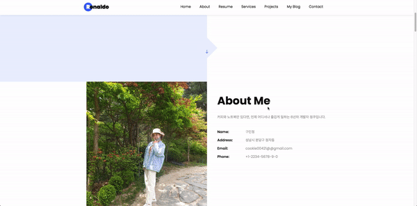

<p align="center">
  <h1 align="center">Developer's Portfolio ✨</h1>

  <p align="center">
Profolio는 개발자를 위한, 쉽고 빠르게 제작 할 수 있는 정적 포트폴리오 템플릿 입니다. <br/>Github 페이지로 호스팅 됩니다. <br/>웹 사이트는 <a href="https://congchu.github.io/web-porfolio/">DEMO</a>에서 확인하실 수 있습니다.
  <br/>
  <br/> 더 많은 템플릿은 <a href="https://github.com/congchu/portfolio-collection" >portfolio-collection</a> 저장소에서 보실 수 있습니다.
    <br/>
    <br/>
    
    
    
  <br/>
  <br/>
  
</p>

## Samples 🎨

원하는 스타일을 골라 시작하세요. 각 샘플은 같은 콘텐츠(**주니어 프론트엔드 개발자 페르소나**)를 서로 다른 레이아웃·톤으로 보여줍니다.

| # | 스타일 | 폴더 | 미리보기 |
| --- | --- | --- | --- |
| 1 | 다크 풀스크린 + 스크롤 애니메이션 (원본) | [`samples/dark-fullscreen/`](./samples/dark-fullscreen/)   | [DEMO](https://congchu.github.io/web-porfolio/samples/dark-fullscreen/) |
| 2 | 라이트 미니멀 + 좌측 고정 사이드바        | [`samples/sidebar-light/`](./samples/sidebar-light/)       | [DEMO](https://congchu.github.io/web-porfolio/samples/sidebar-light/)   |
| 3 | 컬러풀 + 카드 그리드                      | [`samples/colorful-cards/`](./samples/colorful-cards/)     | [DEMO](https://congchu.github.io/web-porfolio/samples/colorful-cards/)  |

루트의 [`index.html`](./index.html)은 위 3개를 한눈에 보는 **갤러리 페이지**입니다. → [https://congchu.github.io/web-porfolio/](https://congchu.github.io/web-porfolio/)

### 폴더 구조

```
.
├── index.html                  # 갤러리 페이지
├── content.md                  # 공통 페르소나 콘텐츠 (단일 소스)
└── samples/
    ├── dark-fullscreen/        # Sample 1 (self-contained)
    │   ├── index.html
    │   ├── single.html
    │   ├── css/ js/ fonts/ scss/
    │   └── images/
    ├── sidebar-light/          # Sample 2 (self-contained)
    │   ├── index.html
    │   └── images/
    └── colorful-cards/         # Sample 3 (self-contained)
        ├── index.html
        └── images/
```

각 샘플 폴더는 **self-contained** — 폴더 통째로 옮겨도 그대로 동작합니다.

### 콘텐츠 수정

페르소나(이름·경력·프로젝트 등)는 [`content.md`](./content.md)에 한 군데 정리되어 있어요. 자기 정보로 갈아끼울 때는 `content.md`를 먼저 다듬은 뒤 각 샘플 HTML에 반영하면 일관성이 유지됩니다.

> 💡 `sidebar-light`·`colorful-cards`는 외부 JS 의존성 없이 단일 HTML로 동작합니다. `dark-fullscreen`은 Bootstrap·jQuery·AOS 등 자원을 자기 폴더 안에 갖고 있어요.

### 원하는 샘플 하나만 쓰고 싶다면

마음에 드는 샘플 폴더 통째로 fork해서 쓰시면 됩니다. 예를 들어 `samples/sidebar-light/`만 떠가서 GitHub Pages에 배포하면 끝.

## Overview ⭐️

- static website로 Github pages 활용한 웹 호스팅 가능
- 개발자 맞춤형 포트폴리오 웹 페이지
- 제작자 표기 시, 무료로 활용가능

## Prerequisites 🍪

- PC에 git이 설치되어 있어야하며, Github 계정이 있어야 합니다.
- HTML 문법을 몰라도 텍스트만 교체하여 활용 가능합니다.
- HTML 문법을 알면 레이아웃이나 디자인을 변경할 수 있습니다.
- CSS를 몰라도 제작 가능하지만, CSS에 친숙하다면 디자인도 자유롭게 변경할 수 있습니다.

## Setup And Deployment 🔧

1. 내 프로젝트로 Fork합니다.
2. repository를 clone하여 로컬로 내려받습니다.

   ```
   git clone {저장소URL}
   ```

3. 내용을 원하는대로 수정합니다.
4. github commit & push 합니다.

```bash
git commit -m 'initial project'
git push - u origin master
```

6. github Settings에서 pages로 이동하여, Source를 main branch로 바꿔줍니다.
7. publish 되었다는 URL로 접속하여 확인합니다 (시간이 좀 걸리니, 5분정도 기다려주세요)

## Documentation 📑

튜토리얼 문서는 [웹 포트폴리오 제작 튜토리얼](https://www.notion.so/cucus/85e3bec77d904f1fa282cec4756232c3)에서 확인해주세요.

## Deploy History 🌳

2026-06-10

- `samples/` 폴더 구조로 정리: `dark-fullscreen`(원본), `sidebar-light`, `colorful-cards`
- 각 샘플을 **self-contained**로 분리 — `css/ js/ fonts/ images/` 자원이 각 폴더 안에 들어감
- 루트 `index.html`을 갤러리 페이지로 교체
- 공통 콘텐츠 단일 소스 `content.md` 추가 (주니어 프론트엔드 페르소나)

2021-12-28

- 지킬 셋팅 제거
- 커스텀 도메인 연결 제거
- 데모 사이트 및 이미지 경로 변경

2021-04-22

- 전체 레이아웃 수정
- header 사진 변경

2021-04-20

- 프로젝트 생성
